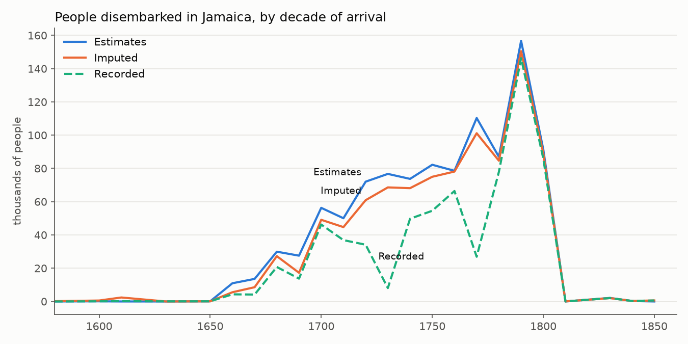
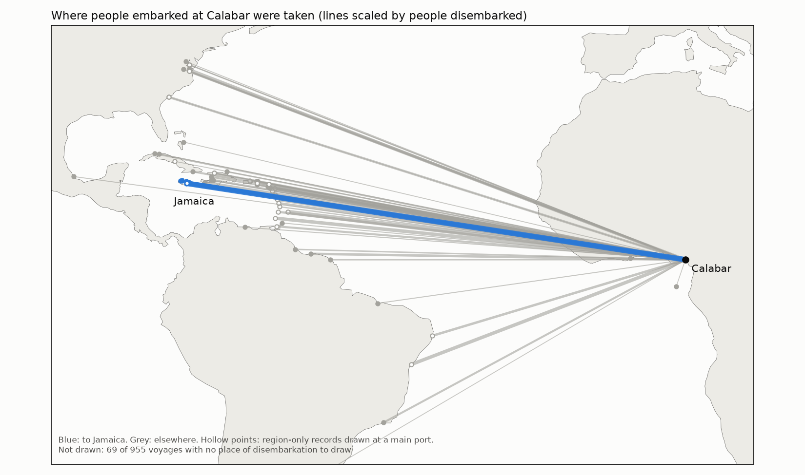
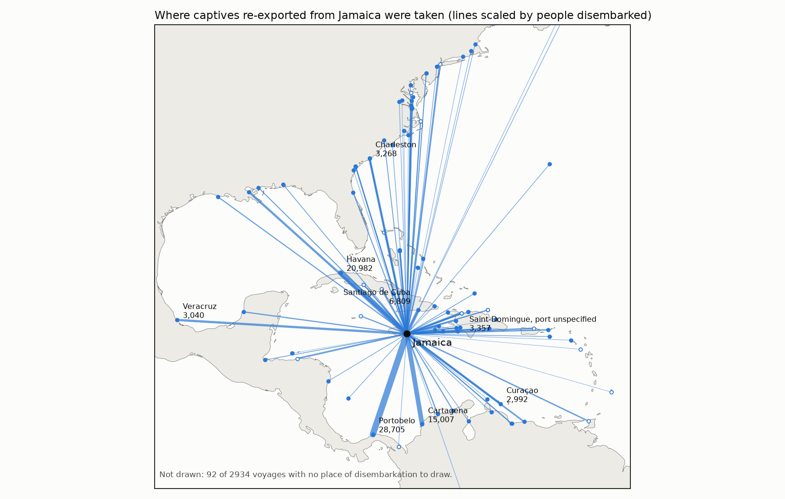
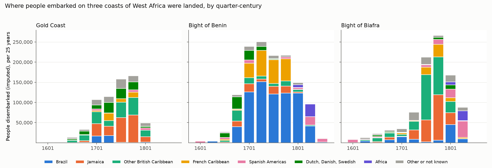

# voyages

A Python library for the [SlaveVoyages](https://www.slavevoyages.org) databases:
the Trans-Atlantic Slave Trade Database, the Intra-American Slave Trade Database,
the Estimates database, and the People of the Atlantic Slave Trade records.

The aim is a clean, typed, provenance-aware data layer with a small query API, so
that a developer or historian can go from the official downloads to a question
answered in a few lines of Python, reproducibly.

**Status: Phase 2 (query layer). Usable for exploration; the API may still change.** See
`PLAN.md` for the roadmap.

## Install (development)

```bash
uv sync
uv run voyages version
uv run voyages fetch        # downloads the official files to ~/.cache/voyages/raw
uv run voyages build        # builds the Parquet tables
uv run pytest
```

Set `VOYAGES_DATA_DIR` to put the raw and built data somewhere else.

## Query

After `uv run voyages build`:

```python
import voyages
from voyages import Voyages

v = Voyages()
df = (v.transatlantic
       .disembarked_in("Jamaica")
       .embarked_from("Bight of Biafra")
       .between(1700, 1800)
       .by_decade(["voyages", "embarked", "disembarked"]))
print(voyages.citation())
```

Places are names or codes at any level (port, region, broad region) and match the
voyage's principal places of embarkation and disembarkation, imputed where the
record is silent, as on the site. Totals are the imputed totals; `df.attrs["provenance"]`
says so. `v.transatlantic.disembarked_in("Jamaica").endpoints()` gives the points to
draw each voyage on a map, and `v.sql("...")` runs any SQL over the tables.

`v.fields(search="captives")` lists the fields, and `v.describe("MAJBUYPT")` shows one with
its provenance, codebook reference and values. `v.query(recorded_only=True)` (or
`--recorded-only`) keeps to data transcribed from historical records, which is public
domain: no imputed field is read.

The same filters work from the command line. Output is CSV on stdout, or a CSV or
Parquet file with `-o`; the citation and licence note go to stderr, and Parquet files
carry them in their metadata:

```bash
voyages query -d transatlantic -e "Bight of Biafra" -l Jamaica --from 1700 --to 1800 --by decade
voyages query -l Jamaica --by endpoints --drawable-only -o jamaica.parquet
```

## Worked analyses

Notebooks in `notebooks/`, each a `.py` source paired with an executed `.ipynb`
(`uv run jupytext --sync notebooks/*.py`, then `uv run jupyter nbconvert --to notebook
--execute --inplace notebooks/<name>.ipynb`; needs the full data).

- [Arrivals in Jamaica by African region of embarkation](notebooks/01_jamaica_arrivals.ipynb):
  recorded, imputed and Estimates figures side by side, decade by decade.



- [Calabar to Jamaica](notebooks/02_calabar_to_jamaica.ipynb): the voyages from Old Calabar,
  where their captives were landed, and how many died on the way, with maps.



- [Re-exports from Jamaica](notebooks/03_jamaica_reexports.ipynb): captives shipped on from
  Jamaica to other colonies, from the Intra-American data: destinations, timing, a comparison
  with arrivals from Africa, and the journeys that can be traced from the African coast.



- [Bight of Biafra, Gold Coast, Bight of Benin](notebooks/04_three_regions_destinations.ipynb):
  where people embarked on three neighbouring coasts were landed, quarter-century by
  quarter-century, and Jamaica's share of each.



## Data and license

The library code is Apache-2.0. The data belongs to SlaveVoyages: records
transcribed from historical documents are public domain; imputed fields and the
Estimates database are CC BY-NC 4.0. See `NOTICE` and `docs/DATA.md`.

```python
>>> import voyages
>>> print(voyages.citation())
SlaveVoyages, Trans-Atlantic Slave Trade Database, https://www.slavevoyages.org (accessed ...).
```
